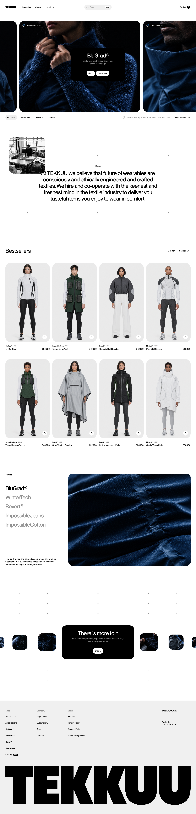

# TEKKUU — landing page example



This is an example of a product page. We built it for the webinar **„Dlaczego AI robi przeciętne UI? Jak radzić sobie z losowością modeli?”** (“Why does AI make average UI? How to deal with the randomness of models?”), hosted by [Design Practice](https://www.designpractice.pl/).

- 🎥 Webinar recording: [youtube.com/watch?v=QvjEKPwDAqo](https://www.youtube.com/watch?v=QvjEKPwDAqo)
- 🎨 Figma project files: [Product Lab AI — Community Resources](https://www.figma.com/design/ZbmNn9OzI6l6TWIsALNRiu/Product-Lab-AI--Community-Resources?node-id=0-1)
- 🎓 The webinar is part of the course [Product Lab AI](https://productlabai.pl/), run by Design Practice.

TEKKUU is a made-up brand. The page is a one-page e-commerce front page with a header, hero carousel, mission, bestsellers, textiles, a “There is more to it” gallery and a footer.

## How we built it

This example mixes three ways to give context to a coding agent:

1. **Prompt** — a short brief for each section. It says what is interactive and what is only a hover state.
2. **Bitmap of the full page** — one image of the whole page ([`docs/landing-page.png`](docs/landing-page.png)), attached to the first prompt. It gives the agent the full picture before it builds anything.
3. **Figma MCP** — for each section, the agent reads the Figma frame through the Figma MCP server. Figma is the source of truth for sizes, spacing and tokens.

The agent builds the page section by section. It does not start the next section before it gets the Figma link and the brief for it. The rules it must keep between sessions live in [`AGENTS.md`](AGENTS.md) (and [`CLAUDE.md`](CLAUDE.md), which loads it).

## Fonts

The page uses two typefaces:

- **PP Neue Montreal** (Medium and Medium Italic) by [Pangram Pangram](https://pangrampangram.com/products/neue-montreal)
- **Geist Mono** by Vercel, for SKUs. It loads from Google Fonts through `next/font/google`, so you do not have to do anything.

> [!IMPORTANT]
> PP Neue Montreal has a commercial licence, so **the font files are not in this repo**. Without them, the project does not build. You have two options:
>
> **A. Use PP Neue Montreal.** Download or buy it from [Pangram Pangram](https://pangrampangram.com/products/neue-montreal), under the licence that fits your use. Put `PPNeueMontreal-Medium.woff2` and `PPNeueMontreal-MediumItalic.woff2` into `app/fonts/`.
>
> **B. Use Inter.** Replace the `fontSans` block in `app/layout.tsx` with this:
>
> ```tsx
> import { Geist_Mono, Inter } from "next/font/google"
>
> const fontSans = Inter({
>   subsets: ["latin"],
>   weight: "500",
>   style: ["normal", "italic"],
>   variable: "--font-sans",
> })
> ```
>
> Then remove the `localFont` import. The page will look a little different from the Figma design, but everything works.

### Logo

> [!WARNING]
> The TEKKUU logo (`public/logo/tekkuu.svg`) is set in **Frama**, a typeface by [Pangram Pangram](https://pangrampangram.com/). The logo falls under the same font licence, so **you cannot use it commercially**. If you reuse this project, we recommend that you replace the logo with your own.

## Run it

You need Node.js 22 or later and [pnpm](https://pnpm.io/).

```bash
pnpm install
pnpm dev
```

Then open [http://localhost:3000](http://localhost:3000).

Other scripts: `pnpm build`, `pnpm lint`, `pnpm typecheck`, `pnpm format`.

## Stack

- [Next.js 16](https://nextjs.org/) (App Router)
- [Tailwind CSS v4](https://tailwindcss.com/) — design tokens in `app/globals.css`
- [shadcn/ui](https://ui.shadcn.com/) (style `base-vega`, on [Base UI](https://base-ui.com/))
- [Motion](https://motion.dev/) for animation

## Where things are

| Section | Files |
| --- | --- |
| Header + Spotlight search (⌘K) | `components/site-header.tsx`, `components/spotlight.tsx` |
| Hero carousel | `components/sections/hero-section.tsx`, `components/hero-carousel.tsx` |
| Mission | `components/sections/mission-section.tsx` |
| Bestsellers | `components/sections/bestsellers-section.tsx` |
| Textiles | `components/sections/textiles-section.tsx` |
| There is more to it | `components/sections/more-section.tsx`, `components/more-carousel.tsx` |
| Footer | `components/site-footer.tsx` |

Product names, SKUs and textile copy are in `lib/catalog.ts`. Images are in `public/images/`.

## Credits

Made for [Design Practice](https://www.designpractice.pl/) and the [Product Lab AI](https://productlabai.pl/) course.
